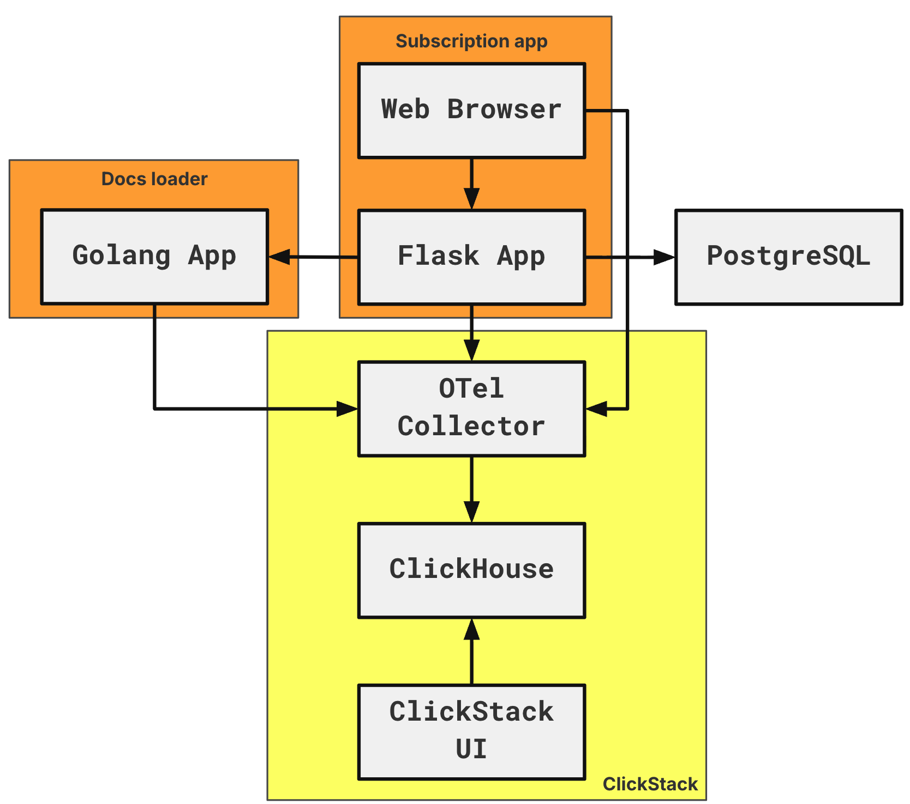

# ClickHouse Subscription Demo App

A Flask-based web application that showcases ClickHouse features while collecting user subscriptions. The backend (Python) and the docs loader (Go) are instrumented with the upstream OpenTelemetry SDKs, and the browser with the HyperDX browser SDK.

## Overview

This project demonstrates ClickStack Observability through full OpenTelemetry instrumentation for monitoring and debugging, both in front-end (browser) and back-end (Python and Go).
After the data is sent from the OpenTelemetry collector to ClickHouse, it is possible to use HyperDX to visualize data and get insights.

## Architecture

=======

## Quick Start

1. **Create a ClickHouse Cloud service**
    - https://console.clickhouse.cloud

2. **Clone the repo**
   ```bash
   git clone https://github.com/ClickHouse/clickstack-demo-subscription-app
   ```

3. **Access the main directory**
   ```bash
   cd clickstack-demo-subscription-app
   ```

4. **Create a .env file**
   ```bash
   CLICKHOUSE_ENDPOINT=<HOST-WITH-PORT>
   CLICKHOUSE_USER=default
   CLICKHOUSE_PASSWORD=<PASSWORD>
   HYPERDX_API_KEY=<INGESTION-PASSWORD>
   ```

5. **Edit .env with the connection information to your service**

6. **Edit .env with your own HyperDX API key to securely ingest data**

7. **Start all services**
   ```bash
   docker compose up -d
   ```

8. **(Optional) Access the subscription app in your browser**
    - http://localhost:8000

## Quick Start with ClickHouse Observability (fully managed)

ClickHouse runs the gateway and the database, so this setup has neither. The app and the browser send to a local OTel agent, which forwards everything to your service.

1. **Create an Observability service** in https://console.clickhouse.cloud, then open **Getting Started** → **View connection details** → **Env vars**.

2. **Create a .env file** and paste the three `OTEL_EXPORTER_OTLP_*` lines as they are. See `.env.managed.example`.

3. **Start all services**
   ```bash
   docker compose -f docker-compose.managed.yml up -d
   ```
   The app uses ports 8000 and 8001, and the agent listens on `localhost:4318` for the browser SDK.

4. **Simulate a deploy** by setting `APP_VERSION` in `.env` (default `1.0.0`) and running step 3 again. Every span and log carries it as `service.version`. To make that version a bad deploy, also set `FAULT_LATENCY_MS` and `FAULT_ERROR_RATE`: signups slow down, a share of them fail, and a new warning appears in the logs. `/health` is never affected.

5. **Burn error budget** by clicking **Docs** on a schedule, which crashes `docs-loader`:
   ```bash
   docker compose -f docker-compose.managed.yml up -d docs-burn
   docker compose -f docker-compose.managed.yml stop docs-burn
   ```
   `DOCS_CLICKS_PER_MINUTE` (default 30) sets how hard it clicks.

## Contributing

1. Fork the repository
2. Create a feature branch (`git checkout -b feature/amazing-feature`)
3. Commit changes (`git commit -m 'Add amazing feature'`)
4. Push to branch (`git push origin feature/amazing-feature`)
5. Open a Pull Request

## Support

- **ClickHouse Documentation**: https://clickhouse.com/docs
- **ClickStack Documentation**: https://clickhouse.com/docs/use-cases/observability/clickstack
